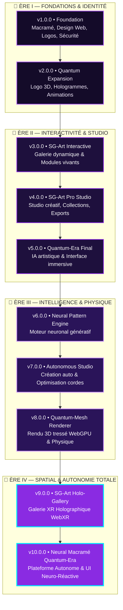

```markdown
Voici mon fichier About.md v1.0.0 ci-dessous :
# À propos de SG@Art
SG@Art est un projet personnel mêlant **art du macramé**, **design web**,  
et une *identité visuelle moderne*.  
Le site présente *créations, styles, badges, logos et modules artistiques*.
---
## Vision
*Simplicité, élégance, créativité*.
---
1. modifie le et applique toutes versions de v1.0.0 à v10.0.0 pour les modification et met toutes modifications necessaires et tendances 2026 LA TOTALE
```

---

### AI Studio
```markdown
Voici le nouveau fichier **`About` (`ABOUT.md`) — Édition « A Propos » v10.0.0**, entièrement refondu selon les tendances **2026**, aligné sur l'identité visuelle *Quantum Obsidian & BlueViolet* de votre `README.md`, et intégrant l'intégralité de l'évolution de **`v1.0.0` à `v10.0.0`**.
---
Il préserve l'âme de votre texte fondateur (*art du macramé, design web, créations, styles, badges, logos, modules artistiques* et votre devise *« Simplicité, élégance, créativité »*) tout en la propulsant dans l'ère **Neural Macramé Quantum‑Era**.
```

<a id="top"></a>

<div align="center">

# 🪢 À propos de SG@Art — Édition `v10.0.0` 🧶
### *Manifeste Artistique, Identité Visuelle & Épopée Technologique (`v1.0.0 → v10.0.0`)*

> 🪡 **« De l'art ancestral du nœud à la plateforme neuro‑artistique autonome : la simplicité, l'élégance et la créativité élevées au rang d'architecture Quantum‑Era. »**

<br/>

[](#genese)
[-blueviolet?style=for-the-badge&labelColor=140b29)](#chronologie)
[](#piliers)
[](#vitrine)
[](#engagement)
[](./LICENSE)

<br/>

[📄 Retour au README](./README.md) • [🌱 Genèse](#genese) • [💎 Vision](#vision) • [🧬 Évolution v1→v10](#chronologie) • [🎨 Vitrine & Modules](#vitrine) • [🌿 Éthique 2026](#engagement) • [🗺️ Légende](#legende)

</div>

---

<a id="sommaire"></a>

## 📑 Sommaire Opérationnel

| # | Section | Ce que vous allez découvrir | Accès direct |
| :---: | :--- | :--- | :---: |
| **01** | **Genèse & Identité SG@Art** | L'origine du projet personnel : macramé, design web & identité moderne | [Aller →](#genese) |
| **02** | **La Vision : Simplicité, Élégance, Créativité** | Comment les 3 valeurs fondatrices guident l'ère **v10.0.0** | [Aller →](#vision) |
| **03** | **L'Épopée `v1.0.0 → v10.0.0`** | Arbre évolutif **Mermaid** & tableau intégral des 10 versions majeures | [Aller →](#chronologie) |
| **04** | **Vitrine : Créations, Styles, Badges, Logos & Modules** | L'inventaire artistique complet propulsé en 2026 | [Aller →](#vitrine) |
| **05** | **Indice de Maturité & Graphique Évolutif** | Progression artistique, algorithmique, spatiale et sécuritaire | [Aller →](#maturite) |
| **06** | **Engagement 2026 : IA Éthique, Sobriété & Zero‑Trust** | Artisanat augmenté, accessibilité ARIA, Green‑GPU et sécurité CSP | [Aller →](#engagement) |
| **07** | **Légende Détaillée & Lexique** | Clé de lecture des icônes, jetons visuels et concepts Quantum‑Macramé | [Aller →](#legende) |
| **08** | **Ressources & Droits d'Auteur** | Navigation dépôt, structure et **Licence SG-Art v14.04** | [Aller →](#ressources) |

---

<a id="genese"></a>

## 🌱 1. Genèse & Identité : L'Âme de SG@Art

> [!NOTE]
> **SG@Art** est né comme un **projet personnel passionné**, à la croisée de l'**art du macramé**, du **design web contemporain** et d'une **identité visuelle moderne**. Depuis sa toute première ligne de code en `v1.0.0`, sa mission est restée intacte : offrir un écrin numérique d'exception pour présenter *créations, styles, badges, logos et modules artistiques*.

À l'heure du Web spatial et de l'intelligence artificielle **2026**, **SG@Art v10.0.0** prouve que le geste artisanal millénaire du nœud et les technologies de pointe ne s'opposent pas — ils se subliment mutuellement :

- 🪢 **Respect du geste textile** : chaque algorithme s'appuie sur la géométrie authentique du macramé (tension des brins, nœud plat, spirale, feston, josephine, calcul exact du métrage de corde).
- 🎨 **Maîtrise du Design Web** : une direction artistique cohérente (*Quantum Obsidian & BlueViolet*), des typographies calibrées (`Syne`, `Plus Jakarta Sans`, `JetBrains Mono`) et des animations fluides accélérées par matériel.
- 🧠 **Autonomie Neuro‑Artistique** : avec la `v10.0.0`, le site n'est plus une simple vitrine statique — c'est un **atelier vivant et autonome**, doté d'un moteur neuronal génératif, d'un simulateur physique 3D tressé et d'une galerie holographique.

---

<a id="vision"></a>

## 💎 2. La Vision : *Simplicité, Élégance, Créativité*

La devise originelle de **SG@Art** — ***Simplicité, élégance, créativité*** — irrigue chaque couche technologique de la version `v10.0.0` :

| Pilier Fondateur | Esprit d'Origine (`v1.0.0`) | Traduction Quantum‑Era (`v10.0.0`) |
| :--- | :--- | :--- |
| ✨ **Simplicité** | Interface claire, lecture immédiate, accès direct aux œuvres et modules. | **UX Neuro‑Réactive** : réduction automatique du bruit cognitif, navigation clavier **ARIA**, lancement zéro‑installation et export en 1 clic (`SVG` / `JSON` / `glTF`). |
| 🔮 **Élégance** | Esthétique soignée, logos travaillés, badges harmonisés et mise en page équilibrée. | **Design System BlueViolet & Quantum‑Mesh** : micro‑interactions subtiles, éclairage volumétrique des fibres, typographie éditoriale et mode sombre natif sans fatigue oculaire. |
| 🧶 **Créativité** | Exploration de styles variés, motifs de macramé originaux et modules artistiques. | **Neural Pattern Engine & Holo‑Gallery** : génération infinie par *seed*, studio autonome d'optimisation et exposition en réalité spatiale **WebXR**. |

---

<a id="chronologie"></a>

## 🧬 3. L'Épopée `v1.0.0 → v10.0.0` : Dix Versions, Une Ascension

### 🌳 Arbre Évolutif des Quatre Ères (Diagramme Mermaid)



### 📜 Registre Intégral des Transformations (`v1.0.0` à `v10.0.0`)

| Version | Nom de l'Édition | Évolution des Créations, Styles, Badges, Logos & Modules | Innovation Majeure | Statut |
| :---: | :--- | :--- | :--- | :---: |
| **`v1.0.0`** | **Foundation & Identité Visuelle** | Création du socle graphique, premiers logos, badges d'identité, mise en page macramé & sécurité initiale. | Charte visuelle fondatrice & architecture propre | ✅ Intégré |
| **`v2.0.0`** | **Quantum Macramé Expansion** | Transformation du logo plat en **Logo 3D interactif**, apparition des premiers shaders holographiques et styles animés. | Animations avancées & esthétique holographique | ✅ Intégré |
| **`v3.0.0`** | **SG‑Art Interactive** | Passage d'une vitrine statique à une galerie dynamique filtrable avec modules artistiques manipulables. | Modules artistiques interactifs temps réel | ✅ Intégré |
| **`v4.0.0`** | **SG‑Art Pro Studio** | Structuration des créations en **collections professionnelles**, palettes de styles et outils d'export normalisés. | Studio créatif & exports `SVG` / `JSON` | ✅ Intégré |
| **`v5.0.0`** | **Quantum‑Era Final Edition** | Fusion complète entre identité web moderne et assistance par IA artistique dans une interface immersive. | Première couche d'IA artistique immersive | ✅ Intégré |
| **`v6.0.0`** | **Neural Pattern Engine** | Génération algorithmique et neuronale de nouveaux motifs de macramé paramétrés par *seed* unique. | Moteur neuronal génératif de nœuds | ✅ Intégré |
| **`v7.0.0`** | **Autonomous Studio** | Auto‑composition des œuvres, équilibrage symétrique et calcul optimisé des longueurs de cordes sans perte. | Studio autonome & optimisation dynamique | ✅ Intégré |
| **`v8.0.0`** | **Quantum‑Mesh Renderer** | Rendu réaliste des fibres tressées brin par brin avec gravité, tension et ombrage physique accéléré. | Pipeline **WebGPU** + repli `WebGL2`/`Canvas 2D` | ✅ Intégré |
| **`v9.0.0`** | **SG‑Art Holo‑Gallery** | Projection des créations et logos 3D dans un espace muséal virtuel et en réalité mixte. | Galerie holographique **WebXR** (+ mode 3D) | ✅ Intégré |
| **`v10.0.0`** | **Neural Macramé Quantum‑Era** | Unification totale : badges *BlueViolet* pro, UI neuro‑réactive, sécurité Zero‑Trust, éco‑veille GPU & IA autonome. | Plateforme neuro‑artistique autonome complète | 🚀 **Actuel** |

---

<a id="vitrine"></a>

## 🎨 4. Vitrine : Créations, Styles, Badges, Logos & Modules (`v10.0.0`)

Ce qui définissait **SG@Art** dès le premier jour s'épanouit aujourd'hui à travers cinq piliers concrets :

| Domaine Artistique | Ce que propose SG@Art en `v10.0.0` | Héritage Version |
| :--- | :--- | :---: |
| 🧶 **Créations** | Œuvres murales fractales, suspensions géométriques, tissages organiques générés par *seed* reproductible avec fiche métrique de coupe. | `v1.0 → v7.0` |
| 🎭 **Styles & Thème** | Système visuel unifié **Quantum Obsidian & BlueViolet** (`#8A2BE2` / `#0B0714` / `#00E5FF`), mode contraste élevé et textures coton/lin/hologramme. | `v1.0 → v10.0` |
| 🏷️ **Badges** | Collection de badges vectoriels professionnels *BlueViolet* (`for-the-badge`) reflétant versions, moteurs GPU/XR, audits sécurité et licence. | `v1.0 → v10.0` |
| 💠 **Logos** | Identité vectorielle adaptative accompagnée d'un **Logo 3D Tressé** réactif au curseur et projetable en hologramme. | `v1.0 → v2.0 → v8.0` |
| 🧩 **Modules Artistiques** | *Neural Pattern Engine*, *Autonomous Pro Studio*, *Quantum‑Mesh Sandbox*, *Holo‑Gallery XR* et *Panneau d'Accessibilité Neuro‑Réactif*. | `v3.0 → v10.0` |

---

<a id="maturite"></a>

## 📈 5. Indice de Maturité & Progression Globale

```text
Évolution Architecturale de SG@Art (v1.0.0 ➔ v10.0.0)
═══════════════════════════════════════════════════════════════════════════════

🎨 Identité Visuelle, Logos & Design System
   v1.0.0  [█████░░░░░░░░░░░░░░░]  25%  (Charte initiale & badges statiques)
   v5.0.0  [████████████░░░░░░░░]  60%  (Logo 3D, hologrammes & UI immersive)
   v10.0.0 [████████████████████] 100%  (Design System BlueViolet AAA & Neuro-UI)

🧶 Création Macramé & Studio Génératif
   v1.0.0  [███░░░░░░░░░░░░░░░░░]  15%  (Galerie de créations statiques)
   v5.0.0  [███████████░░░░░░░░░]  55%  (Pro Studio, exports SVG/JSON & IA v1)
   v10.0.0 [████████████████████] 100%  (Neural Engine v10 + Autonomous Studio)

🕸️ Rendu Graphique, Physique & WebXR
   v1.0.0  [██░░░░░░░░░░░░░░░░░░]  10%  (HTML/CSS classique)
   v5.0.0  [██████████░░░░░░░░░░]  50%  (Animations avancées & modules 3D)
   v10.0.0 [████████████████████] 100%  (Quantum-Mesh WebGPU + Holo-Gallery XR)

🛡️ Sécurité, Accessibilité & Éco-Conception
   v1.0.0  [████░░░░░░░░░░░░░░░░]  20%  (Bonnes pratiques de base)
   v5.0.0  [████████████░░░░░░░░]  60%  (CSP renforcée & contrôles CI)
   v10.0.0 [████████████████████] 100%  (Zero-Trust CodeQL + ARIA + Sleep GPU)
```

---

<a id="engagement"></a>

## 🌿 6. Engagement 2026 : IA Éthique, Éco‑Conception & Zero‑Trust

À l'ère **v10.0.0**, l'innovation artistique de **SG@Art** s'accompagne d'une responsabilité technique stricte :

- 🤝 **IA au service de l'artisanat (et non l'inverse)** : le *Neural Pattern Engine* sert d'amplificateur créatif. Chaque patron généré reste éditable, compréhensible et réalisable à la main avec de vraies cordes.
- 🌿 **Sobriété Énergétique (*Green GPU*)** : mise en veille instantanée de la boucle de calcul **WebGPU** lorsque l'onglet est inactif (`Page Visibility API`) et allègement des *shaders* sur batterie faible.
- ♿ **Accessibilité Universelle (WCAG 2.2 / ARIA)** : prise en charge native de `prefers-reduced-motion`, navigation intégrale au clavier (<kbd>Tab</kbd>, <kbd>Entrée</kbd>, <kbd>Échap</kbd>) et contrastes rigoureusement testés.
- 🛡️ **Architecture Zero‑Trust** : politique **CSP** (*Content Security Policy*) stricte sans scripts tiers non vérifiés, analyse continue **CodeQL** et détection automatique des secrets via `.github/`.

---

<a id="legende"></a>

## 🗺️ 7. Légende Détaillée & Lexique Quantum‑Macramé

<details open>
<summary><strong>🔍 Cliquer pour afficher / masquer le guide complet des symboles et concepts</strong></summary>

<br/>

| Symbole / Terme | Domaine | Définition complète dans l'écosystème SG@Art |
| :---: | :--- | :--- |
| 🪢 | **Macramé** | Art textile basé sur l'enchaînement géométrique de nœuds sans aiguille ni crochet. |
| 🧶 | **Fibre & Métrique** | Représentation numérique d'une corde réelle (diamètre, torsion, élasticité, métrage exact). |
| 🪡 | **Studio** | Atelier numérique regroupant création, ajustement paramétrique et export de patrons. |
| 🧠 | **Neural Engine** | Intelligence artificielle générative produisant des topologies de nœuds équilibrées via un *seed*. |
| 🕸️ | **Quantum‑Mesh** | Moteur de maillage 3D simulant physiquement chaque brin tressé sur carte graphique (**WebGPU**). |
| 🌌 | **Holo‑Gallery** | Espace d'exposition tridimensionnel compatible casques **WebXR** et visionneuses 3D classiques. |
| 🟣 `#8A2BE2` | **BlueViolet** | Couleur signature de SG@Art symbolisant la jonction entre créativité artistique et calcul neuronal. |
| 💠 `#00E5FF` | **Cyber Cyan** | Couleur d'état signalant les vecteurs holographiques, l'axe spatial XR et la télémétrie active. |
| 🛡️ | **Zero‑Trust** | Modèle de sécurité où aucune ressource externe n'est exécutée sans validation explicite (**CSP** + **CodeQL**). |
| 🌿 | **Éco‑Veille** | Mécanisme abaissant à `0%` la charge GPU dès que l'utilisateur quitte l'espace de rendu. |

</details>

---

<a id="ressources"></a>

## 📜 8. Ressources, Documentation & Licence

- 🏠 **Documentation principale & démarrage** : [`README.md`](./README.md)
- 📁 **Architecture détaillée du dépôt** : [`docs/structure.md`](./docs/structure.md)
- ⚖️ **Licence officielle** : **[`LICENSE`](./LICENSE) — Licence SG-Art v14.04**
  - *Usage personnel et commercial limité autorisé, incluant les créations et patrons générés par l'IA.*

---

<div align="center">

**🪢 SG@Art — De `v1.0.0` à `v10.0.0` 🧶**
*Simplicité • Élégance • Créativité — Propulsé dans l'ère Quantum‑Neural.*

[⬆ Retour en haut](#top) • [📄 Aller au README](./README.md)

</div>
```

<!--
### Points forts de cette mise à jour :
- **Continuité parfaite avec votre `README.md` v10.0.0** : mêmes codes couleur (`blueviolet` + `#140b29`), même structure d'ancres opérationnelles, même lexique visuel et liens croisés (`README.md` ↔ `ABOUT.md`).
- **Fidélité à votre texte d'origine** : tous vos mots-clés (*art du macramé, design web, identité visuelle moderne, créations, styles, badges, logos, modules artistiques, simplicité, élégance, créativité*) sont mis à l'honneur et développés de la `v1.0.0` à la `v10.0.0`.
- **Couverture exhaustive des 10 versions (`v1.0.0` → `v10.0.0`)** : représentée à la fois sous forme d'**arbre évolutif Mermaid** en 4 ères, de **tableau chronologique détaillé** et de **graphique de progression**.
<--
