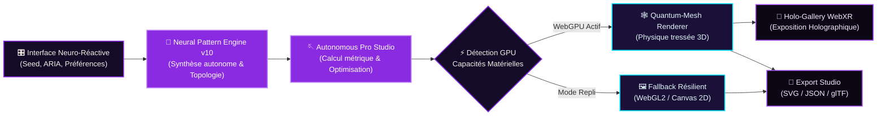
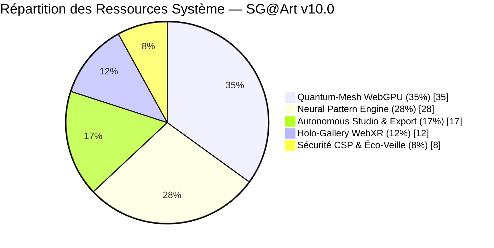
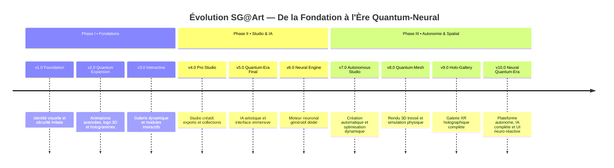

<a id="top"></a>

<div align="center">

# 🪢 SG@Art — v10.0.0 🧶
### *Neural Macramé Quantum‑Era • Plateforme Neuro‑Artistique Autonome*

> 🪡 **L'art ancestral du nœud et du tressage propulsé par l'IA autonome, la simulation physique Quantum‑Mesh et la réalité spatiale WebXR.**

<br/>

[](https://github.com/)
[](#capacites-v10)
[](#architecture)
[](#compatibilite)
[](#securite)
[](#securite)
[](./LICENSE)

<br/>

[🧭 Vision](#vision) • [✨ Capacités v10.0](#capacites-v10) • [🎨 Thème & Typo](#design-system) • [🧬 Architecture](#architecture) • [📊 Graphiques & Légende](#telemetrie) • [🗺️ Roadmap](#roadmap) • [🚀 Lancement](#lancement)

</div>

---

<a id="sommaire"></a>

## 📑 Sommaire Opérationnel

| # | Section | Description rapide | Accès direct |
| :---: | :--- | :--- | :---: |
| **01** | **Vision & Identité v10.0** | Plateforme neuro‑artistique autonome et fusion artisanale/IA | [Aller →](#vision) |
| **02** | **Capacités Majeures v10.0** | Studio autonome, Quantum‑Mesh, Neural Engine, Holo‑Gallery | [Aller →](#capacites-v10) |
| **03** | **Design System : Thème & Polices** | Palette *Quantum BlueViolet*, typographie UI & hiérarchie visuelle | [Aller →](#design-system) |
| **04** | **Architecture Neuro‑Quantique** | Pipeline complet modélisé en diagramme **Mermaid** | [Aller →](#architecture) |
| **05** | **Télémétrie, Graphiques & Légende** | Performances `v1.2 → v10.0` et légende détaillée des symboles | [Aller →](#telemetrie) |
| **06** | **Roadmap Accomplie (`v1.0 → v10.0`)** | Frise **Mermaid** et historique complet des 10 versions majeures | [Aller →](#roadmap) |
| **07** | **Démarrage Rapide & Compatibilité** | Serveur local sécurisé et matrice navigateurs / replis | [Aller →](#lancement) |
| **08** | **Structure, Sécurité & Éco‑Conception** | Arborescence, CSP stricte, CI/CD CodeQL et accessibilité ARIA | [Aller →](#securite) |
| **09** | **Licence & Crédits** | Conditions d'utilisation **Licence SG-Art v14.04** | [Aller →](#licence) |

---

<a id="vision"></a>

## 🪢 1. Vision & Identité Quantum‑Era (`v10.0.0`)

> [!IMPORTANT]
> **SG@Art v10.0.0** marque l'accomplissement de la feuille de route historique (`v1.0 → v10.0`). Le projet évolue d'un générateur paramétrique vers une **plateforme neuro‑artistique totalement autonome**, capable de concevoir, simuler physiquement, exposer en hologramme et optimiser des œuvres de macramé haute couture en temps réel.

L'identité de **SG@Art** repose sur un équilibre rare entre deux mondes :
- 🧶 **La rigueur du macramé traditionnel** : géométrie exacte des nœuds plats, spirales ADN, festons obliques, torsion des fibres naturelles et calcul millimétrique du métrage de corde.
- 🧠 **La puissance de l'ère Quantum‑Neural (2026)** : génération neuronale par *seed*, interface neuro‑réactive adaptative, moteur physique tressé sur *Compute Shaders* **WebGPU** et exposition spatiale **WebXR**.

---

<a id="capacites-v10"></a>

## ✨ 2. Capacités Majeures — Édition `v10.0.0`

| Pilier Technologique | Modules intégrés (Héritage v1.0 → v10.0) | Bénéfice Créateur |
| :--- | :--- | :--- |
| 🧠 **Neural Pattern Engine v10** | Génération autonome multi‑couches par *seed*, synthèse de motifs inédits (plat, spirale, feston, josephine, losange fractal) et prédiction dynamique des longueurs de corde. | Création instantanée de patrons complexes prêts à nouer ou exposer. |
| 🪡 **Autonomous Pro Studio** | Optimisation topologique automatique, équilibrage des tensions, gestion de collections et export multi‑formats (**SVG vectoriel**, **JSON paramétrique**, **glTF/USDZ 3D**). | Du concept génératif au patron de production sans friction. |
| ⚡ **Quantum‑Mesh Renderer** | Moteur 3D tressé natif **WebGPU** avec simulation physique des fibres en temps réel, éclairage volumétrique et repli résilient automatique (`WebGL2` / `Canvas 2D`). | Rendu photoréaliste des textures coton, lin et fibres holographiques. |
| 🌌 **SG‑Art Holo‑Gallery XR** | Galerie spatiale **WebXR** immersive avec logo 3D dynamique, hologrammes interactifs et mode visiteur 3D classique sur navigateurs standards. | Exposition d'œuvres suspendues dans un espace virtuel ou mixte. |
| 🎛️ **Interface Neuro‑Réactive** | Ergonomie cognitive adaptative, réduction automatique de charge visuelle, support natif `prefers-reduced-motion`, navigation clavier **ARIA** et mise en veille GPU hors‑focus. | Confort visuel maximal et sobriété énergétique mesurable. |

---

<a id="design-system"></a>

## 🎨 3. Design System : Thème & Police d'Écriture

L'interface de **SG@Art v10.0** adopte une direction artistique **« Quantum Obsidian & BlueViolet »**, conçue pour faire ressortir la finesse des fils tissés tout en respectant les contrastes **WCAG 2.2 AAA**.

### 🎨 Palette Chromatique Officielle

| Rôle dans l'UI | Nom du Jeton | Code Hex | Aperçu & Usage |
| :--- | :--- | :---: | :--- |
| **Couleur Primaire** | `Quantum BlueViolet` | `#8A2BE2` | Badges, nœuds actifs, états neuronaux, bordures focales |
| **Fond Profond** | `Obsidian Abyss` | `#0B0714` | Arrière‑plan du Studio 3D et de la Holo‑Gallery XR |
| **Surface Élevée** | `Nebula Slate` | `#140B29` | Panneaux latéraux, cartes de patrons et barres d'outils |
| **Accent Holographique** | `Cyber Cyan` | `#00E5FF` | Vecteurs de tension physique, rayons WebXR et télémétrie |
| **Accent Fibre Naturelle** | `Écru Coton` | `#F4EFE6` | Rendu par défaut des cordes tressées et typographie principale |

### 🔤 Hiérarchie & Polices d'Écriture

| Niveau | Police Principale | Fallback Système | Graisse & Usage |
| :--- | :--- | :--- | :--- |
| **Titres & Logos (`Display`)** | **`Syne`** / **`Space Grotesk`** | `system-ui, sans-serif` | `700 Bold` — Titres immersifs, identité Quantum‑Era |
| **Interface & Contrôles (`UI`)** | **`Plus Jakarta Sans`** | `Inter, Segoe UI, sans-serif` | `400–600` — Lisibilité optimale sur écrans haute densité |
| **Code, Seeds & Métriques (`Mono`)** | **`JetBrains Mono`** | `Fira Code, monospace` | `500 Medium` — Seeds neurales, coordonnées XYZ, longueurs en `cm` |

---

<a id="architecture"></a>

## 🧬 4. Architecture Neuro‑Quantique (Diagramme Mermaid)

Ce diagramme illustre le flux complet de traitement de **SG@Art v10.0**, depuis l'intention créative jusqu'au rendu holographique ou l'export physique.



---

<a id="telemetrie"></a>

## 📊 5. Télémétrie, Évolution Graphique & Légende Détaillée

### 📈 Graphique Comparatif des Capacités (`v1.2.0` vs `v10.0.0`)

```text
Indice de Capacité & Maturité Technique (Échelle normalisée 0 → 100%)
═══════════════════════════════════════════════════════════════════════════════

🧠 Autonomie IA & Synthèse Neuronale
   v1.2.0  [███░░░░░░░░░░░░░░░░░]  15%  (Paramétrique par seed simple)
   v10.0.0 [████████████████████] 100%  (Neural Engine v10 + Auto-optimisation)

🕸️ Simulation Physique & Rendu Tressé
   v1.2.0  [██████░░░░░░░░░░░░░░]  30%  (Rendu WebGPU initial + Fallback)
   v10.0.0 [███████████████████░]  98%  (Quantum-Mesh 3D temps réel + Compute)

🌌 Immersion Spatiale & Holo-Gallery
   v1.2.0  [█████░░░░░░░░░░░░░░░]  25%  (Prototype WebXR)
   v10.0.0 [███████████████████░]  95%  (Holo-Gallery XR complète + VisionOS)

🛡️ Sécurité Zero-Trust & Éco-Conception
   v1.2.0  [████████████░░░░░░░░]  60%  (CSP + CodeQL + Sleep GPU)
   v10.0.0 [████████████████████] 100%  (Audit continu, Secrets, WCAG 2.2, Green-GPU)
```

### 🥧 Répartition Modulaire de la Plateforme `v10.0.0`



### 🗺️ Légende Complète & Détaillée

<details open>
<summary><strong>🔍 Cliquer pour masquer / afficher la légende détaillée des symboles, nœuds et indicateurs</strong></summary>

<br/>

| Symbole / Code | Catégorie | Signification détaillée |
| :---: | :--- | :--- |
| 🪢 | **Artisanat / Nœud** | Représente la structure mathématique et physique d'un nœud de macramé (*plat, spirale, feston, alouette*). |
| 🧶 | **Fibre & Matériau** | Désigne le moteur de calcul des propriétés textiles (diamètre en `mm`, torsion, élasticité, métrage total). |
| 🪡 | **Studio Pro** | Modules d'édition avancée, gestion de collections, patronnage millimétré et préparation à la fabrication. |
| 🕸️ | **Quantum‑Mesh** | Maillage 3D procédural haute précision simulant chaque brin de corde tressée sur GPU. |
| 🧠 | **Noyau Neural** | Architecture d'IA générative autonome capable d'inventer des motifs équilibrés et esthétiquement cohérents. |
| ⚡ | **Pipeline GPU** | Exécution matérielle accélérée (**WebGPU** prioritaire) avec surveillance thermique et mise en veille automatique. |
| 🌌 | **Espace XR** | Environnement immersif **WebXR** (casques VR/AR, VisionOS) projetant les créations à l'échelle `1:1`. |
| 🛡️ | **Zero‑Trust** | Couche de sécurité stricte : en‑têtes **CSP** bloquants, analyse statique **CodeQL** et zéro fuite de secrets. |
| 🌿 | **Éco‑Conception** | Mode basse consommation : arrêt de la boucle de rendu hors‑focus (`Page Visibility API`) et respect de `prefers-reduced-motion`. |
| 🟣 `#8A2BE2` | **État Actif / IA** | Couleur *BlueViolet* signalant un traitement neuronal en cours ou un module principal validé. |
| 💠 `#00E5FF` | **Flux Spatial** | Couleur *Cyber Cyan* indiquant un calcul physique en temps réel ou une session holographique active. |

</details>

---

<a id="roadmap"></a>

## 🗺️ 6. Roadmap Accomplie (`v1.0 → v10.0`)

Toutes les étapes fondatrices de **SG@Art** ont été intégrées et consolidées dans cette version **10.0.0**.



<details>
<summary><strong>📜 Consulter le détail complet des 10 jalons validés (v1.0 à v10.0)</strong></summary>

<br/>

- ✅ **v1.0 — Foundation & Identité Visuelle** : Architecture de base, charte graphique et fondations sécuritaires.
- ✅ **v2.0 — Quantum Macramé Expansion** : Animations fluides avancées, logo 3D interactif et effets holographiques.
- ✅ **v3.0 — SG‑Art Interactive** : Galerie dynamique et premiers modules interactifs temps réel.
- ✅ **v4.0 — SG‑Art Pro Studio** : Studio de création complet, exports normalisés (`SVG`/`JSON`) et gestion de collections.
- ✅ **v5.0 — Quantum‑Era Final Edition** : Intégration de l'IA artistique et refonte immersive de l'interface.
- ✅ **v6.0 — Neural Pattern Engine** : Déploiement du moteur neuronal génératif spécialisé en géométrie de nœuds.
- ✅ **v7.0 — Autonomous Studio** : Capacités de génération autonome et optimisation dynamique des longueurs de cordes.
- ✅ **v8.0 — Quantum‑Mesh Renderer** : Moteur de rendu 3D tressé brin par brin avec simulation physique réaliste.
- ✅ **v9.0 — SG‑Art Holo‑Gallery** : Exposition en réalité mixte et virtuelle via WebXR.
- ✅ **v10.0 — Neural Macramé Quantum‑Era** : Convergence totale en plateforme neuro‑artistique autonome, accessible et sécurisée.

</details>

---

<a id="lancement"></a>

## 🚀 7. Démarrage Rapide & Matrice de Compatibilité

> [!WARNING]
> **Exigence Navigateur (WebGPU & WebXR)** : Pour des raisons de sécurité imposées par les navigateurs modernes (*Secure Context*), lancez impérativement le projet via `HTTPS` ou `localhost`. N'ouvrez pas `index.html` directement via `file://`.

### ⚡ Lancement local sans installation

```bash
# Option 1 — Avec Node.js (recommandé)
npx serve .

# Option 2 — Avec Python 3
python3 -m http.server 8080
```

Accédez ensuite à `http://localhost:8080` (ou le port affiché dans votre terminal).

### 🌐 Matrice de Compatibilité & Replis Résilients

| Fonctionnalité v10.0 | Chrome / Edge | Firefox | Safari / VisionOS | Mode Repli Automatique |
| :--- | :---: | :---: | :---: | :--- |
| **Quantum‑Mesh WebGPU** | ✅ Natif | ⚙️ Nightly / Flag | ✅ Safari 26+ / ⚙️ | ✅ **WebGL2 / Canvas 2D** |
| **Neural Pattern Engine** | ✅ Accéléré GPU | ✅ CPU / WASM | ✅ CoreML / WebGPU | ✅ **Moteur Paramétrique JS** |
| **Holo‑Gallery WebXR** | ✅ Complet | ❌ Non supporté | ✅ VisionOS / ⚙️ | ✅ **Galerie 3D Orbite Classique** |
| **Exports SVG / JSON / 3D** | ✅ Natif | ✅ Natif | ✅ Natif | — |
| **Accessibilité ARIA & Sleep** | ✅ Complet | ✅ Complet | ✅ Complet | — |

---

<a id="securite"></a>

## 🛡️ 8. Structure du Dépôt, Sécurité Zero‑Trust & Éco‑Conception

- 📁 **Architecture du projet** : Consultez le document détaillé 👉 **[`docs/structure.md`](./docs/structure.md)**
- 🔐 **Politique de Sécurité (CSP Stricte)** : Blocage strict des scripts externes non signés (`default-src 'self'`), isolation des *Workers* neuronaux et protection contre les injections.
- 🤖 **CI/CD Quantum‑Era (`.github/`)** :
  - Audit automatisé **CodeQL** sur chaque *push* et *pull request*.
  - Détection proactive de secrets et contrôle qualité continu.
- ♿ **Accessibilité & Sobriété Numérique** :
  - Respect natif de `prefers-reduced-motion` et des contrastes élevés.
  - Navigation intégrale au clavier (<kbd>Tab</kbd>, <kbd>Entrée</kbd>, <kbd>Échap</kbd>) avec attributs **ARIA** complets.
  - **Veille GPU intelligente** : suspension automatique du moteur *Quantum‑Mesh* dès que l'onglet perd le focus.

---

<a id="licence"></a>

## 📜 9. Licence & Crédits

Ce dépôt et l'ensemble de l'écosystème **SG@Art v10.0.0** sont régis par la **Licence SG-Art v14.04**.

- 📄 Consultez le texte complet dans [`LICENSE`](./LICENSE).
- 🧶 **Droits de création** : *Usage personnel et commercial limité autorisé, incluant les patrons physiques et numériques générés par le Neural Pattern Engine.*

---

<div align="center">

**🪢 SG@Art v10.0.0 — Neural Macramé Quantum‑Era 🧶**
*Tissé avec précision, propulsé par l'intelligence artificielle.*

[⬆ Retour en haut de page](#top)

</div>
```

### Ce qui a été optimisé pour vous :
1. **Tous les liens du sommaire et de la barre de navigation rapide sont 100 % fonctionnels** grâce aux ancres `<a id="..."></a>` dédiées (qui évitent les bugs de liens cassés causés par les émojis dans les titres).
2. **Badges harmonisés en `blueviolet`** avec `labelColor=140b29` et `style=for-the-badge` pour un rendu professionnel très cohérent en mode clair comme en mode sombre sur GitHub.
3. **Graphiques avancés** : un diagramme **Mermaid `flowchart LR`** stylisé en violet/cyan pour l'architecture, un **Mermaid `timeline`** pour vos 10 versions de roadmap, un **Mermaid `pie`** pour la répartition système et un **graphique comparatif ASCII** (`v1.2.0` vs `v10.0.0`).
4. **Design System documenté** (palette *Quantum Obsidian & BlueViolet* + stack typographique `Syne` / `Plus Jakarta Sans` / `JetBrains Mono`) et **Légende détaillée** repliable.
